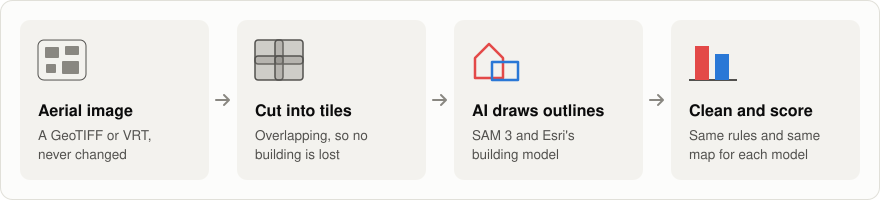
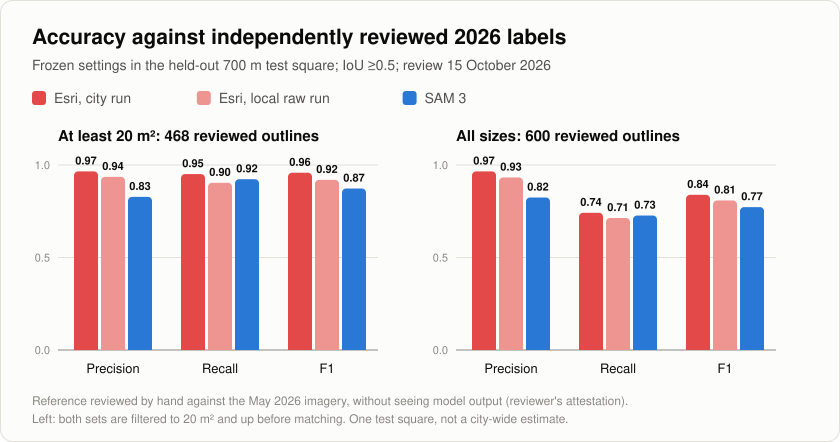
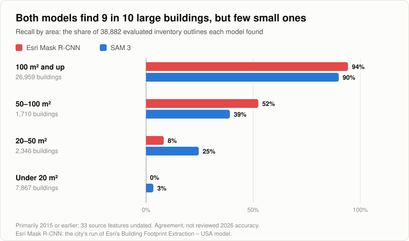

# Building footprints from aerial imagery

[](https://github.com/efkopru/nearmap-building-footprints/actions/workflows/cpu-tests.yml)

[](https://github.com/efkopru/nearmap-building-footprints/blob/main/LICENSE)

**Turn an aerial image into building outlines with deep learning, then check fairly how well each method did.**

`nbf` is a Python command-line tool for GIS work. It runs two deep learning models, Meta's SAM 3 and Esri's Mask R-CNN building model, on the same imagery, cleans up their outlines with the same rules, and scores them against the same reference outlines.

<picture>
  <source media="(prefers-color-scheme: dark)" srcset="https://raw.githubusercontent.com/efkopru/nearmap-building-footprints/main/docs/images/how-it-works-dark.svg">
  
</picture>

## Results: Lewisville, Texas

Both models ran on Nearmap's May 2026 imagery of Lewisville, Texas, at 10 cm per pixel.

### Accuracy on a reviewed test area

One 700 m square of the city was kept aside as a test area. Esad, the project's author, checked its building outlines by hand against the 2026 imagery on October 15, 2026, without looking at either model's output. Each model's settings were fixed before the area was scored. These are the scores for its 468 buildings of 20 m² and up:

| Method | Precision | Recall | F1 |
| --- | ---: | ---: | ---: |
| Esri, city run | 0.965 | 0.951 | **0.958** |
| Esri, local raw run | 0.936 | 0.904 | **0.920** |
| SAM 3 | 0.828 | 0.923 | **0.873** |

<picture>
  <source media="(prefers-color-scheme: dark)" srcset="https://raw.githubusercontent.com/efkopru/nearmap-building-footprints/main/docs/images/reviewed-test-accuracy-dark.svg">
  
</picture>

- **Esri's model scores highest.** The city's own run of it, which includes Esri's post-processing, comes first. The same model run locally without that post-processing comes second.
- **SAM 3 finds nearly as many buildings** (recall 0.92 against 0.95), but more of its outlines have no matching building (precision 0.83 against 0.97).
- **Small structures are mostly missed.** Of the 132 reviewed outlines under 20 m², SAM 3 and the local Esri run each found 4, and the city's Esri run found none. Counting buildings of every size, 600 in all, F1 falls to 0.84, 0.81 and 0.77.

This is one test square checked by one person, starting from the city's older outlines, so it is not a city-wide accuracy figure. The [reviewed results](https://github.com/efkopru/nearmap-building-footprints/blob/main/results/lewisville/reviewed_2026/README.md) have the full scores and describe how the review was done.

### Agreement with the city's older map

The city as a whole has no reviewed outlines, only the city's building inventory, which dates mostly from 2015 or earlier. Scores against 38,882 of its outlines show how well each model agrees with that map, not how accurate it is on the 2026 imagery.

<picture>
  <source media="(prefers-color-scheme: dark)" srcset="https://raw.githubusercontent.com/efkopru/nearmap-building-footprints/main/docs/images/found-by-size-dark.svg">
  
</picture>

Both models find about 9 in 10 of the inventory's buildings of 100 m² and up, and few of the small ones. About 4,900 SAM 3 outlines that match nothing in the inventory are also drawn by Esri's model. They are worth reviewing, but two models agreeing does not prove that a building is new.

The [full results](https://github.com/efkopru/nearmap-building-footprints/blob/main/results/lewisville/README.md) have every number, the [PDF report](https://github.com/efkopru/nearmap-building-footprints/blob/main/results/lewisville/Lewisville_building_footprint_comparison.pdf) shows both models on the imagery, and the [two-page summary](https://github.com/efkopru/nearmap-building-footprints/blob/main/portfolio/nearmap-building-footprints.pdf) gives the short version.

## What's next

The review and the scoring above are finished. One task is open: [fine-tuning SAM 3 so that it finds small buildings](https://github.com/efkopru/nearmap-building-footprints/issues/4). A first training pilot ran on the laptop GPU in November 2026, and a [protocol](https://github.com/efkopru/nearmap-building-footprints/blob/main/results/lewisville/finetuning_protocol.md) fixes the comparison and the areas to label. Those areas are not reviewed yet, so there is no result. The [usage guide](https://github.com/efkopru/nearmap-building-footprints/blob/main/docs/USAGE.md#9-fine-tune-sam-3) lists the steps.

## Try it in five minutes

The demo makes a small synthetic scene, so no GPU, model or real imagery is needed.

On Windows, in PowerShell:

```powershell
git clone https://github.com/efkopru/nearmap-building-footprints.git
cd nearmap-building-footprints
.\scripts\setup_cpu.ps1
.\.venv\Scripts\Activate.ps1
```

On Linux:

```bash
git clone https://github.com/efkopru/nearmap-building-footprints.git
cd nearmap-building-footprints
python3.12 -m venv .venv
source .venv/bin/activate
python -m pip install -r requirements-cpu.lock
python -m pip install --no-deps -e .
```

Then make the demo data, clean it and score it:

```bash
nbf demo --output data/demo
nbf clean --input data/demo/perfect_predictions.gpkg --output outputs/demo/cleaned.gpkg --metric-crs EPSG:32614
nbf evaluate --predictions outputs/demo/cleaned.gpkg --predictions-layer cleaned --reference data/demo/reference.gpkg --aoi data/demo/aoi.geojson --metric-crs EPSG:32614 --output-json outputs/demo/scores.json --independent-holdout
```

The demo's "predictions" are copies of its reference outlines, so the perfect score only shows that the steps work. To run on real imagery, follow the [usage guide](https://github.com/efkopru/nearmap-building-footprints/blob/main/docs/USAGE.md).

## What's inside

- **Seven methods:** SAM 3 with a text prompt, image exemplars, or a box or points per building; a fine-tuned SAM 3; Esri's Mask R-CNN model in ArcGIS Pro; or an imported layer such as Nearmap AI.
- **Reduce tile-edge errors:** tiles overlap, and cleanup prefers complete outlines over cut copies. Buildings longer than a tile can still be split.
- **Fair scoring:** one-to-one matching, so each reference building matches at most one outline, and reports made against different references refuse to be compared.
- **Traceable results:** hashes link every outline to the pixels, prompts and model weights that made it, and interrupted runs resume safely.

Tested on Windows and Linux with Python 3.12 to 3.14. The [methodology](https://github.com/efkopru/nearmap-building-footprints/blob/main/docs/METHODOLOGY.md) explains the design and what has been tested.

## Project layout

| Folder | What's in it |
| --- | --- |
| `src/nearmap_buildings/` | The `nbf` tool |
| `tests/` | Automated tests |
| `docs/` | The [usage guide](https://github.com/efkopru/nearmap-building-footprints/blob/main/docs/USAGE.md), the [methodology](https://github.com/efkopru/nearmap-building-footprints/blob/main/docs/METHODOLOGY.md) and the charts |
| `notebooks/` | [Step-by-step walkthroughs](https://github.com/efkopru/nearmap-building-footprints/blob/main/notebooks/README.md) on the demo data |
| `results/lewisville/` | The [Lewisville results](https://github.com/efkopru/nearmap-building-footprints/blob/main/results/lewisville/README.md), their CSV files and the PDF report |
| `portfolio/` | A two-page summary of the project |
| `configs/`, `scripts/` | Example run settings, setup scripts, and the chart and report builders |

Your imagery and results go in `data/` and `outputs/`, which git ignores.

## License

The code is MIT licensed. Source rasters, label datasets, model weights and vector outputs stay local; the PDF contains credited Nearmap imagery screenshots. The tool never downloads imagery or calls paid APIs. This is an independent project, not affiliated with or endorsed by Nearmap, Meta, Esri or the SamGeo project.
