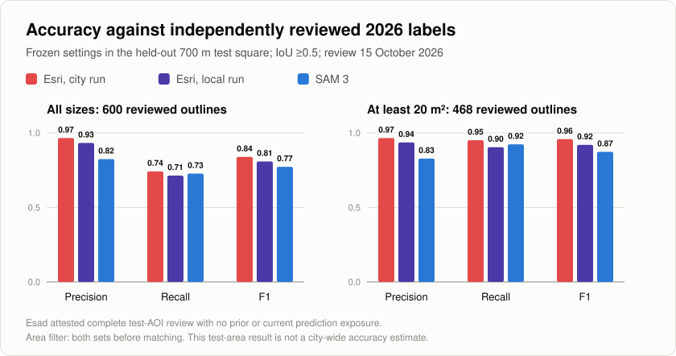

# Building footprints from aerial imagery: SAM 3 and Esri

The project compares Meta's SAM 3 with Esri's pretrained Building Footprint Extraction model on May 2026 Nearmap imagery of Lewisville, Texas. A Python toolkit prepares imagery, runs or imports predictions, cleans geometry, and evaluates every method using shared rules. The imagery workflow processed 21.1 gigapixels at approximately 10 cm resolution.

**Updated October 15, 2026:** manual reference review and the frozen accuracy evaluation are complete. [Issue #2](https://github.com/efkopru/nearmap-building-footprints/issues/2) and [issue #3](https://github.com/efkopru/nearmap-building-footprints/issues/3) are closed after [PR #29](https://github.com/efkopru/nearmap-building-footprints/pull/29). Small-building fine-tuning in [issue #4](https://github.com/efkopru/nearmap-building-footprints/issues/4) is deferred.

## Reviewed test-area results

The primary evaluation uses 468 reviewed buildings of at least 20 m² in one 700 m test square. Both predictions and references are filtered by area before matching. The all-size evaluation separately uses 600 reviewed buildings. Forty additional reviewed outlines cross the square's boundary and are excluded from scoring.

| Method | Precision, ≥20 m² | Recall, ≥20 m² | F1, ≥20 m² | F1, all sizes |
| --- | ---: | ---: | ---: | ---: |
| Esri, city run | 0.965 | 0.951 | **0.958** | **0.839** |
| Esri, local raw run | 0.936 | 0.904 | 0.920 | 0.808 |
| SAM 3 | 0.828 | 0.923 | 0.873 | 0.772 |

The methods use frozen predictions and settings. This evaluation did not rerun inference or tune on the reviewed test labels. Scoring uses one-to-one matching at IoU ≥ 0.5 in EPSG:26914. The [published tables and provenance](../results/lewisville/reviewed_2026/README.md) record counts, settings, review attestations and input fingerprints.

Esad reviewed the test area using aerials and historical outlines, and confirmed no exposure to SAM 3 or Esri predictions before or during that review. The documented labeling rules were followed with no unresolved cases. Coverage and independence are reviewer attestations; geometry checks do not establish them. The reviewed reference inherits unchanged geometry and building-splitting conventions from the historical inventory. No second independent reviewer is recorded.

The all-size reference contains 132 outlines under 20 m². SAM 3 and local Esri each match four of them; city Esri matches none. These are size-based diagnostics from the all-size matching, not building-type classifications or differences obtained by subtracting the two evaluation totals.

## Historical inventory agreement

Earlier city-wide results compare predictions with 38,882 historical outlines retained for evaluation from a 38,924-record source inventory. Most source dates are 2015 or earlier; 33 records are undated, and those undated records remain in the evaluated set. These results remain historical agreement measurements and are preserved separately.

| Method | City-wide F1, ≥20 m², against historical outlines |
| --- | ---: |
| Esri, city run | 0.834 |
| Esri, local raw run | 0.766 |
| SAM 3 | 0.744 |

Outlines absent from that inventory are candidates for review. Absence does not establish construction dates or prove that a prediction is a building. Differences between historical and reviewed scores reflect the changed reference and scoring policy, not model improvement. The reviewed test square does not establish city-wide accuracy.

## Engineering

- **Shared evaluation:** consistent geometry cleanup, maximum-cardinality one-to-one matching, boundary rules, and explicit reference provenance.
- **Resumable inference:** tile manifests and hashes link predictions to inputs and detect changed artifacts.
- **ArcGIS execution:** chunk ownership and periodic worker restarts support the local Esri workflow.
- **Reproducible reporting:** public aggregate CSVs generate charts and reports; raw imagery, reviewed labels, prediction geometry and full receipts remain outside Git. The full report retains its previously published screenshots.
- **Verification:** automated tests run on Windows and Ubuntu; four walkthrough notebooks document preparation, inference and comparison. Public data permits report regeneration, not a complete reproduction of private-data evaluation.

Tile overlap reduces edge losses but does not guarantee complete outlines. Buildings longer than a tile can remain split. The city-published and local Esri outputs also have different processing histories, so their difference cannot be attributed solely to the model.

## Remaining work

The frozen reference and published results remain unchanged. Issue #4 requires geographically separate training, validation and fresh test areas. Every eligible building in those areas must be labeled, including houses, garages and sheds. The fresh test review must avoid prediction exposure. Training feasibility on the 6 GB GPU remains unverified; no training run, new checkpoint or fine-tuning result is claimed. Labeling packages for this work have not yet been prepared.

## Files and guides

- [Two-page public summary](nearmap-building-footprints.pdf)
- [Full report, 11 pages](../results/lewisville/Lewisville_building_footprint_comparison.pdf)
- [Results and historical comparisons](../results/lewisville/README.md)
- [Usage guide](../docs/USAGE.md)
- [Methodology](../docs/METHODOLOGY.md)
- [Walkthrough notebooks](../notebooks/README.md)
- [Repository](https://github.com/efkopru/nearmap-building-footprints)

Rebuild the two-page summary from public CSVs with `python scripts/build_portfolio_summary.py` after installing `reportlab` and `pypdf` in the reporting environment. The builder reads no imagery or private labels, validates the new PDF, then replaces the published summary.
