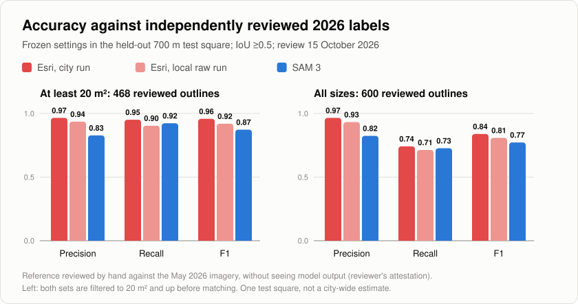
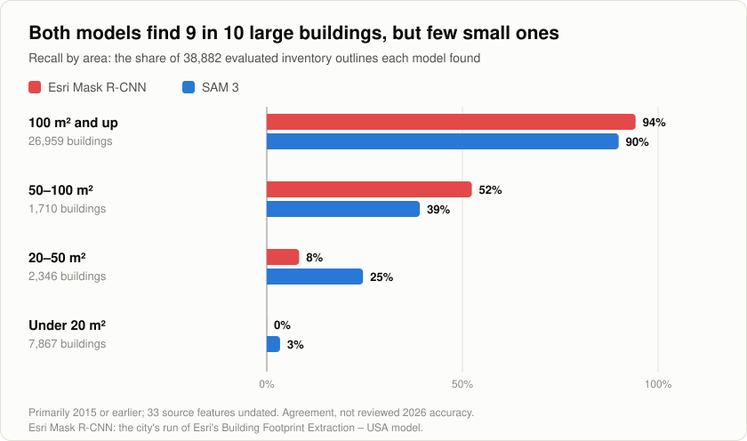
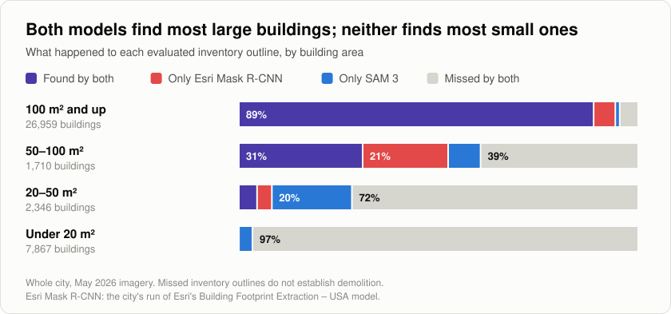
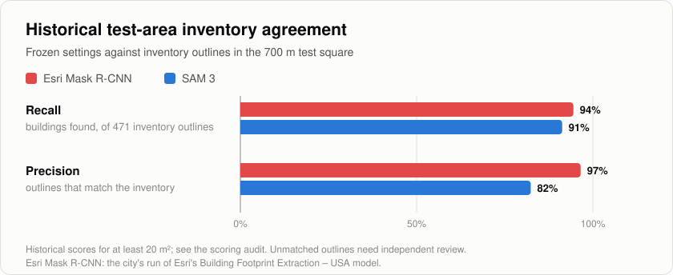

# Lewisville, Texas: results

SAM 3 and Esri's Mask R-CNN building model on Nearmap's May 2026 imagery of Lewisville, Texas (10.16 cm per pixel). **Reviewed accuracy is reported for one held-out test square.** The earlier city-wide, test-area and Old Town inventory comparisons are retained below as historical agreement results. The [PDF report](Lewisville_building_footprint_comparison.pdf) includes the reviewed results and eight existing screenshots of both models on the imagery (imagery: Nearmap, May 2026).

**Status:** the reference review and the frozen accuracy evaluation were completed on October 15, 2026. What is still open is listed under [Next steps](#next-steps).

Three runs are compared:

- **Esri, city run:** Esri's Building Footprint Extraction – USA model (Mask R-CNN) with its standard post-processing, run by the city on the same imagery and published.
- **SAM 3:** the text prompt "building", 1536 px tiles and a confidence threshold of 0.7.
- **Esri, local raw run:** the same Esri model run here without that post-processing, with a confidence threshold of 0.9.

## Reviewed test-area accuracy

Esad finished reviewing the Old Town and test-area references against the imagery on October 15, 2026. The test review used only the aerial imagery and the historical outlines, with no SAM 3 or Esri predictions seen before or during it, and followed the documented rules with no unresolved cases. Complete coverage and independence are the reviewer's own statements, recorded in the [review provenance](reviewed_2026/provenance.json). The frozen test reference has **640 outlines: 600 fully inside the 700 m square and 40 crossing its edge**.

The settings were chosen on the Old Town inventory under the [frozen protocol](tuning_protocol.md) and not retuned here, and the existing predictions were reused. Differences from the historical scores therefore come from the new reference and the explicit area filter, not from better models. The primary evaluation leaves out outlines crossing the square's edge, removes predictions and reference outlines **under 20 m² before matching**, then matches one to one at IoU ≥ 0.5 in EPSG:26914. That leaves 468 reviewed buildings.

| Method | Matched (TP) | Extra (FP) | Missed (FN) | Precision | Recall | F1 | Median IoU |
| --- | ---: | ---: | ---: | ---: | ---: | ---: | ---: |
| Esri, city run | 445 | 16 | 23 | 0.965 | 0.951 | **0.958** | 0.761 |
| SAM 3 | 432 | 90 | 36 | 0.828 | 0.923 | **0.873** | 0.758 |
| Esri, local raw run | 423 | 29 | 45 | 0.936 | 0.904 | **0.920** | 0.793 |

<picture>
  <source media="(prefers-color-scheme: dark)" srcset="https://raw.githubusercontent.com/efkopru/nearmap-building-footprints/main/docs/images/reviewed-test-accuracy-dark.svg">
  
</picture>

**All sizes.** A separate evaluation, not derived from the one above, matches the full 600-building reference without an area filter. The review drew buildings down to about 4 m², and its three outlines just under that are kept as reviewed:

| Method | Matched (TP) | Extra (FP) | Missed (FN) | Precision | Recall | F1 | Median IoU |
| --- | ---: | ---: | ---: | ---: | ---: | ---: | ---: |
| Esri, city run | 445 | 16 | 155 | 0.965 | 0.742 | **0.839** | 0.761 |
| SAM 3 | 436 | 93 | 164 | 0.824 | 0.727 | **0.772** | 0.757 |
| Esri, local raw run | 428 | 31 | 172 | 0.932 | 0.713 | **0.808** | 0.792 |

Of the 132 reviewed outlines under 20 m², SAM 3 and the local Esri run each match 4 (3.0% recall) and the city's Esri run none. The [size diagnostics](reviewed_2026/test_area_by_size.csv) summarize this all-size matching by each outline's own area, so a matched pair can fall in two classes; they do not replace the filtered evaluation above. Full-precision [scores](reviewed_2026/test_area_scores.csv) and the [scope and provenance](reviewed_2026/README.md) are stored with them.

**Limits.** This is one test square, with labels corrected from the historical inventory rather than redrawn: unchanged outlines and building identities are inherited from it, and no second reviewer is recorded. The result does not establish accuracy city-wide or in other places. Old Town was reviewed too, but it is the area used for tuning, not a second held-out test. Labels, imagery, full receipts and individual matches stay local.

## Historical inventory agreement

Everything below predates the review and is scored against the city's public building inventory instead. It has 38,924 source features, dated mostly 2015 or earlier (33 are undated); 38,882 of them are scored city-wide, and the other 42 cross the evaluation boundary or lie outside it ([reference provenance](reference_provenance.json)). The tables and charts call them the "2015 outlines". The original CSVs are unchanged.

**How to read these numbers.** They measure agreement with an older map, not accuracy on the 2026 imagery. An extra outline (a false positive against the inventory) may be a building the inventory lacks, a changed structure, a roof-versus-ground or registration difference, or a model error. A missed outline may be hidden, mapped differently or no longer there. Where both models draw an outline the inventory lacks, that is a candidate to review, not a reference label: both models can make the same mistake. Neither the scores, the screenshots nor the inventory's collection dates show when a building was built or removed.

The main findings:

- **On the historical test-area comparison,** F1 on inventory outlines of 20 m² and up was 0.95 for the city's Esri run, 0.91 for the local Esri run and 0.87 for SAM 3.
- **Esri leads city-wide,** with F1 0.83 against SAM 3's 0.74 on buildings of 20 m² and up. Both find most of them (recall 0.85 and 0.82), but SAM 3 draws more outlines the 2015 map lacks (precision 0.68 against 0.82).
- **Small structures are missed.** Of the 7,867 outlines under 20 m², SAM 3 found 267 and the city's Esri run 2.
- **Model agreement identifies review candidates.** 4,923 SAM 3 outlines without an inventory match also match an Esri outline.
- **Large buildings break up.** SAM 3 splits buildings longer than a tile where tiles meet, and Esri's outlines are cut at its chip edges.
- **Settings matter.** Without Esri's post-processing, the same model scores F1 0.77 instead of 0.83. For SAM 3, 1536 px tiles and a confidence threshold of 0.7 raised Old Town F1 from 0.48 to 0.53.

## Whole city: historical inventory agreement

All three runs went through the same cleanup and were scored against the 38,882 inventory outlines. SAM 3 ran on 6,538 tiles; the local Esri run in 150 chunks.

<picture>
  <source media="(prefers-color-scheme: dark)" srcset="https://raw.githubusercontent.com/efkopru/nearmap-building-footprints/main/docs/images/found-by-size-dark.svg">
  
</picture>

| Method | Outlines | Matched (TP) | Extra (FP) | Missed (FN) | Precision | Recall | F1 | F1, 20 m² and up | Median IoU |
|---|---|---|---|---|---|---|---|---|---|
| Esri, city run | 32,608 | 26,502 | 6,106 | 12,380 | 0.81 | 0.68 | 0.74 | 0.83 | 0.77 |
| SAM 3 | 37,906 | 25,758 | 12,148 | 13,124 | 0.68 | 0.66 | 0.67 | 0.74 | 0.80 |
| Esri, local raw run | 38,860 | 26,536 | 12,324 | 12,346 | 0.68 | 0.68 | 0.68 | 0.77 | 0.80 |

SAM 3's matched outlines fit slightly more tightly (median IoU 0.80 against 0.77).

<picture>
  <source media="(prefers-color-scheme: dark)" srcset="https://raw.githubusercontent.com/efkopru/nearmap-building-footprints/main/docs/images/outcomes-by-size-dark.svg">
  
</picture>

| Building area | 2015 outlines | Found by Esri | Found by SAM 3 | Both | Only Esri | Only SAM 3 | Neither |
|---|---|---|---|---|---|---|---|
| 100 m² and up | 26,959 | 25,410 (94%) | 24,245 (90%) | 23,947 | 1,463 | 298 | 1,251 |
| 50–100 m² | 1,710 | 896 (52%) | 669 (39%) | 530 | 366 | 139 | 675 |
| 20–50 m² | 2,346 | 194 (8%) | 577 (25%) | 107 | 87 | 470 | 1,682 |
| under 20 m² | 7,867 | 2 (0%) | 267 (3%) | 1 | 1 | 266 | 7,599 |

Most of the 11,207 outlines missed by both (7,599) are under 20 m². Adding the local Esri run, 10,463 are missed by all three.

**SAM 3 against Esri, without the inventory.** Matched to each other, the two models form 29,567 pairs with a median IoU of 0.81: 91% of Esri's outlines have a SAM 3 partner and 78% of SAM 3's have an Esri one.

**What the screenshots show.** In a residential area missing from the inventory, both models outline the visible houses. At an apartment complex, Esri outlines long carport rows that SAM 3 mostly misses. In another residential area, SAM 3 outlines more back-yard garages and sheds. Long industrial roofs are split where SAM 3's tiles meet, and some inventory outlines overlap apparently open ground.

## Test area: historical inventory agreement

This is the same seeded-random 700 m square as the reviewed evaluation above, scored against the inventory before the October 2026 review. Each model's settings were frozen first (see [tuning](#old-town-baseline-and-tuning) below) and are exactly the settings of the city-wide runs.

<picture>
  <source media="(prefers-color-scheme: dark)" srcset="https://raw.githubusercontent.com/efkopru/nearmap-building-footprints/main/docs/images/test-area-dark.svg">
  
</picture>

| Method | Matched (TP) | Extra (FP) | Missed (FN) | Precision | Recall | F1 | Median IoU | F1, all sizes |
|---|---|---|---|---|---|---|---|---|
| Esri, city run | 445 | 16 | 26 | 0.97 | 0.94 | 0.95 | 0.76 | 0.83 |
| SAM 3 | 430 | 92 | 41 | 0.82 | 0.91 | 0.87 | 0.75 | 0.76 |
| Esri, local raw run | 422 | 30 | 49 | 0.93 | 0.90 | 0.91 | 0.79 | 0.80 |

Buildings of 20 m² and up, except the last column. Agreement was much higher here than in Old Town, with the methods in the same order; the cause of that difference has not been established. At most 2 of the 136 inventory outlines under 20 m² were found.

**How the 20 m² rows were scored.** The protocol requires removing predictions and reference outlines under 20 m² before matching, which `nbf evaluate --min-area-m2 20` now does. The historical CSVs are kept as published. The [scoring audit](scoring_audit.md) reproduces all six of their city and test rows for 20 m² and up by keeping the matches of one all-size matching only when both outlines are at least 20 m². Filtering before matching gives the same counts in the test square, so the numbers do not show which order was used originally. The whole city and the 176 tuning variants were not rerun with the filter.

## Old Town: baseline and tuning

**Baseline.** The first comparison used a 700 m square around Old Town with 319 of the 2015 outlines, with every method at its default settings: SAM 3 at 1024 px tiles and a confidence threshold of 0.5, and the local Esri run at 0.5.

| Method | Matched (TP) | Extra (FP) | Missed (FN) | Precision | Recall | F1 | Median IoU |
|---|---|---|---|---|---|---|---|
| SAM 3 | 142 | 287 | 177 | 0.33 | 0.45 | 0.38 | 0.74 |
| Esri, city run | 135 | 63 | 184 | 0.68 | 0.42 | 0.52 | 0.75 |
| Esri, local raw run | 158 | 381 | 161 | 0.29 | 0.50 | 0.37 | 0.74 |

All three found 63–71% of the outlines of 50 m² and up, but at most 10% of the smaller ones.

**Tuning.** The goal, fixed in advance in the [tuning protocol](tuning_protocol.md), was the best F1 on buildings of 20 m² and up in the Old Town square. With no reviewed outlines available, tuning used the 2015 outlines ([Amendment 1](tuning_protocol.md#amendment-1-2026-09-29)). The rule froze the highest F1, or, within 0.01 of it, the variant closest to the defaults. Best F1 for some of the 176 variants (all are in [tuning_final.csv](tuning_final.csv)):

| Method | Setting | Precision | Recall | F1 |
|---|---|---|---|---|
| Esri, city run | as published (frozen) | 0.69 | 0.55 | 0.61 |
| SAM 3 | "building", 2048 px, ≥ 0.75 | 0.60 | 0.48 | 0.54 |
| SAM 3 | "building", 1536 px, ≥ 0.7 (frozen) | 0.53 | 0.52 | 0.53 |
| Esri, local raw run | ≥ 0.9 (frozen) | 0.56 | 0.50 | 0.53 |
| SAM 3 | "house", 1536 px, ≥ 0.7 | 0.60 | 0.42 | 0.50 |
| SAM 3 | "roof", 2048 px, ≥ 0.75 | 0.54 | 0.46 | 0.49 |
| SAM 3 | "building", 1024 px, ≥ 0.75 | 0.48 | 0.47 | 0.48 |

For SAM 3, bigger tiles and higher confidence thresholds help up to about 0.75; above that, recall falls faster than precision rises. Its best variant (2048 px, 0.54) was within 0.01 of 1536 px at 0.7, so the rule kept the latter. Regularization never changed a score and stays off.

## Runtime on a laptop RTX 4050 (6 GB)

| Run | Area | Time |
|---|---|---|
| SAM 3, 1536 px tiles | whole city, 6,538 tiles | 2 h 41 min (median 1.08 s per tile) |
| SAM 3, 1024 px tiles | Old Town, 90 tiles | 105 s (0.82 s per tile) |
| Esri, local raw run | whole city, 150 chunks | 8 h 46 min of model time |
| Esri, local raw run | Old Town, 0.64 km² | 4.9 min |

SAM 3 used up to 96% of the GPU's memory, close to the limit but stable through the city-wide run.

## How the runs were made

- **Imagery:** a Nearmap mosaic from May 2026 at 10.16 cm, clipped to the city limits. Its GeoTIFF declared the wrong CRS (a local one in metres); it is EPSG:2276 in US survey feet, fixed with a VRT without resampling and checked against the city limits.
- **Historical reference:** the City of Lewisville's public inventory [described above](#historical-inventory-agreement). The report observed alignment to within about 0.4 m; that does not establish label completeness or temporal accuracy. The reviewed test uses the separate October 2026 reference.
- **Esri, city run:** `ExtractFeaturesUsingAIModels` with default settings. **Local raw run:** `DetectObjectsUsingDeepLearning` without non-maximum suppression (NMS); city-wide in 150 overlapping chunks of about 1.1 km, each keeping only the outlines centred in its own core.
- **SAM 3:** text prompt through SamGeo 1.4.2 at a pinned commit; 1536 px tiles overlapping by 192 px.
- **Cleanup and scoring:** prediction cleanup uses a 4 m² minimum and duplicate removal. Every method is scored in EPSG:26914 with one-to-one matching at IoU ≥ 0.5, leaving out buildings that cross an area's edge. The 20 m² filter is described with each set of results above.
- **Screenshot areas** were picked by a fixed rule and kept at least 500 m from the Old Town and test squares.

## Next steps

The open task is [#4](https://github.com/efkopru/nearmap-building-footprints/issues/4): fine-tuning SAM 3 to raise its low recall on small buildings. A pilot in November 2026 showed that training runs on the 6 GB laptop GPU with the model's two backbones frozen. What it needs now is labels: separate training, validation and fresh test areas in which every visible roof is outlined, with the completed test area kept out of training and setting selection. The [fine-tuning guide](../../docs/USAGE.md#9-fine-tune-sam-3) lists the steps.

The pilot also compared the reviewed Old Town outlines with the imagery, because they were to be its training labels ([#43](https://github.com/efkopru/nearmap-building-footprints/issues/43)). Of the 393, 92 show no visible roof: the spot is parking, grass, bare ground or unbroken tree canopy. That includes 51 of the 69 outlines under 20 m². At least eight buildings have no outline. Old Town was the tuning area, so no reviewed accuracy score rests on it. The test area was reviewed in the same way and has not been rechecked, so read its small-building rows as counts against the reviewed outlines, not as a measured miss rate.

Validation in more areas, a second independent reviewer and better handling of large buildings at tile seams are possible later work. None of them is started.

## Verify and rebuild published artifacts

Run these commands from the repository root:

```bash
# Requires the preserved local evaluation evidence; checks without rerunning it.
python scripts/publish_reviewed_accuracy.py --check

# Uses committed aggregate CSVs to rebuild the public figures.
python scripts/make_charts.py

# Uses public aggregate data and the existing report's eight screenshots.
python scripts/build_lewisville_report.py
```

The PDF builder requires Edge or Chrome and the report packages: `python -m pip install -e ".[report]"`. Public aggregates are enough to rebuild the presentation artifacts, but not to reproduce geometric accuracy scoring without the private inputs. The completed evaluation receipt, predictions and reviewed labels must remain unchanged.

**Files:** [reviewed test scores and provenance](reviewed_2026/README.md), [historical reference provenance](reference_provenance.json), [citywide_scores.csv](citywide_scores.csv), [citywide_by_size.csv](citywide_by_size.csv), [test_area_scores.csv](test_area_scores.csv), [old_town_scores.csv](old_town_scores.csv), [old_town_by_size.csv](old_town_by_size.csv), [tuning_final.csv](tuning_final.csv), the [tuning protocol](tuning_protocol.md) and the [PDF builder](../../scripts/build_lewisville_report.py). The October 2026 revision adds reviewed test results while retaining historical values and screenshots; no new model inference was run.
